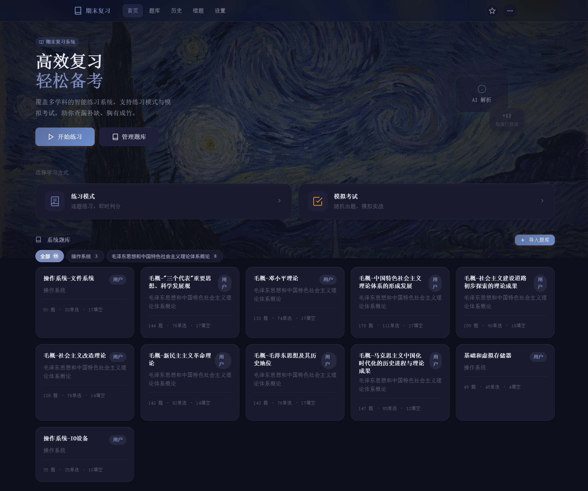
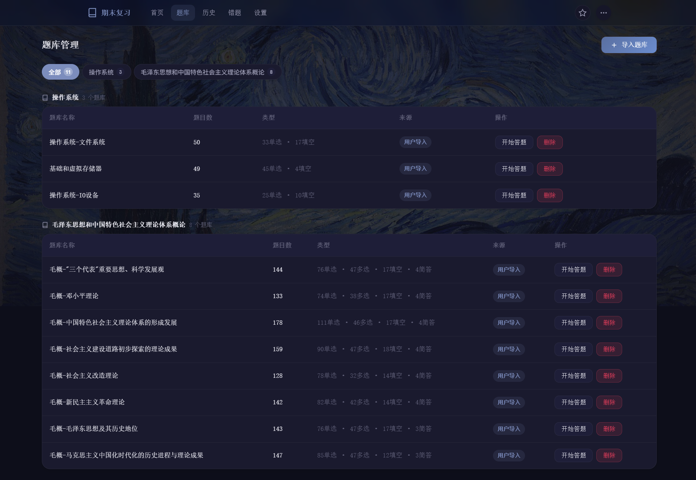
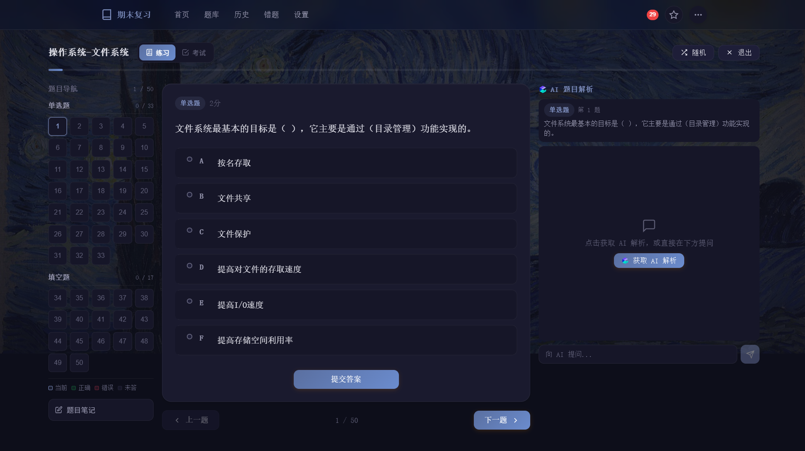
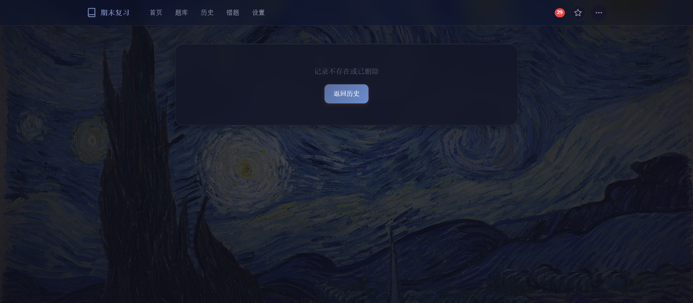
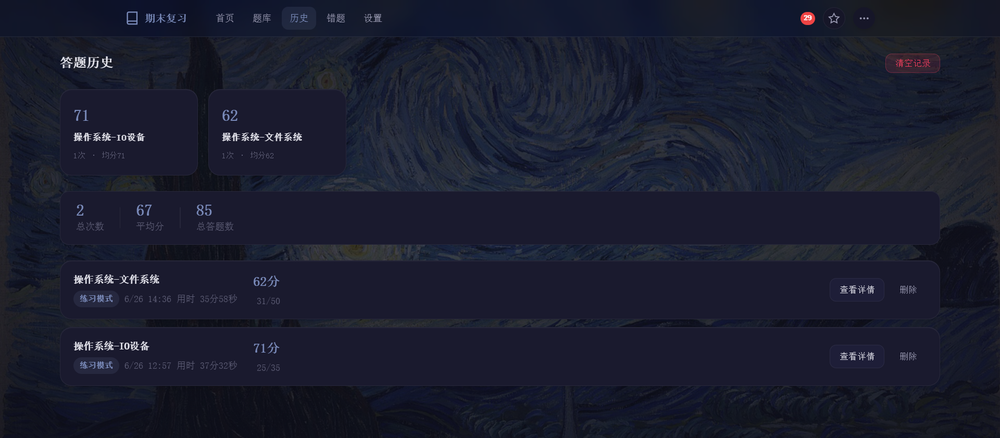
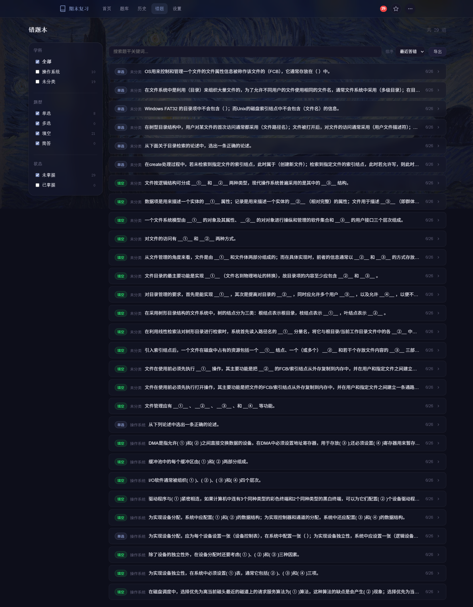
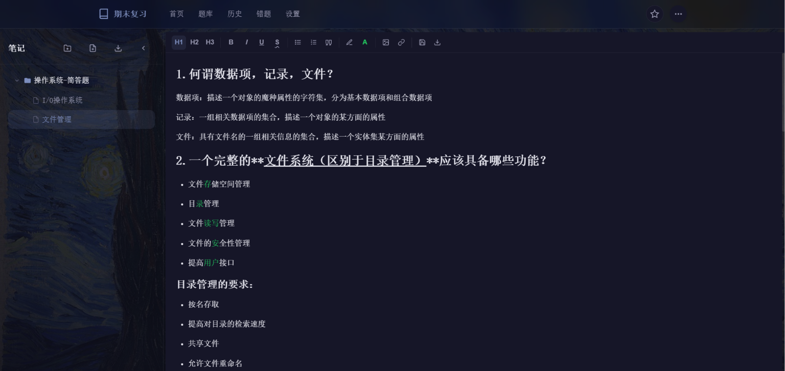
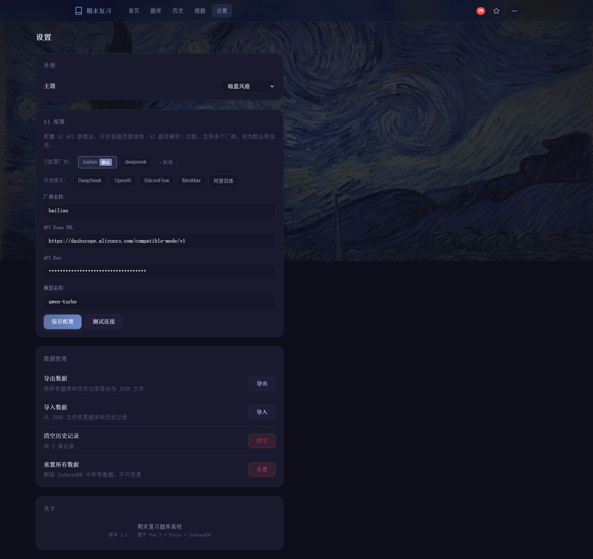

# FinalPrep - 期末复习题库系统

<div align="center">

[](https://github.com/shy20057/finalPreview/releases)
[](https://github.com/shy20057/finalPreview/releases)
[](https://vuejs.org/)

</div>

FinalPrep 是一个基于 Vue 3 + FastAPI 构建的在线练习与考试系统，支持单选题、多选题、填空题等多种题型，提供练习模式和考试模式，帮助学生高效完成期末复习。后端同时提供基于 LangChain / LangGraph / DeepAgents 的学习教练 Agent：只读工具直接执行，写操作会先中断等待你批准、修改或拒绝。

移动端迁移工程位于 [`mobile/`](mobile/)，采用 uni-app Vue 3，当前按方案 A 逐页还原原网页，首要目标为 Android。请用 HBuilderX 单独导入 `mobile/`；环境配置、模拟器运行和待验证清单见[移动端指南](docs/mobile/README.md)。已完成源码迁移、原网页与移动端资源构建，并在 Android 模拟器中完成登录、四种题型交卷和笔记保存验证；当前像素级一致性仍在验收，详细证据见[验证记录](docs/mobile/VERIFICATION.md)。从网页工程到 uni-app 具体改了什么，见[迁移说明](docs/mobile/MIGRATION.md)。所有文档索引见 [docs/](docs/README.md)。



---

## 功能特性

### 核心功能

| 功能 | 说明 |
|------|------|
| 题库管理 | 内置题库与自定义题库导入，支持 JSON 格式题库文件 |
| 练习模式 | 随机出题、实时判分、错题自动收录 |
| 考试模式 | 固定顺序、锁定答案、模拟真实考试环境 |
| 错题本 | 智能收集错题、针对性训练、掌握度追踪 |
| 历史记录 | 完整答题记录、按题库分类统计、正确率趋势分析 |
| 笔记系统 | 层级文件夹结构、Markdown 富文本编辑 |
| AI 学习教练 | LangChain/LangGraph/DeepAgents Agent，只读直接执行、写操作等人审批 |

### AI 学习教练（人在环中）

网页端顶部「AI 助手」进入。Agent 用工具读你的题库、错题、笔记，写操作一律先中断等你点头：

| 工具 | 类型 | 作用 |
|------|------|------|
| `list_banks` / `get_bank_questions` / `list_wrong_questions` / `search_notes` | 只读 | 直接执行 |
| `create_note` / `save_quiz_note` / `add_favorite` / `delete_note` | 写 | 中断等待审批 |

审批卡片支持三种决定：**批准**、**修改参数**（改完 JSON 再执行）、**拒绝**（理由会转达给 Agent）。中断状态存在 SQLite 检查点里，刷新页面或重启后端后对话和待批项都还在。

接口：

| 方法 | 路径 | 说明 |
|------|------|------|
| POST | `/api/agent/chat` | 发送消息，返回消息与待审批项 |
| POST | `/api/agent/resume` | 提交审批决定并继续运行 |
| GET | `/api/agent/history` | 恢复会话（刷新后不丢） |

### 支持题型

- **单选题** - 单项选择，四个选项
- **多选题** - 多项选择，可能有多个正确答案
- **填空题** - 填写空白处答案
- **简答题** - 开放性问答

---

## 界面预览

### 题库管理



按科目分类展示题库，显示题目数量和类型分布，支持导入和删除操作。

### 答题界面



清晰的题目展示，直观的答题进度指示，支持多种题型作答。

### 答题结果



分数统计与正确率展示，正确答案对比分析，错题自动收录至错题本。

### 历史记录



完整的答题历史记录，按题库分类统计各项数据。

### 错题本



自动收集练习过程中的错题，支持针对训练和掌握度追踪。

### 笔记系统



层级文件夹结构，支持 Markdown 富文本编辑，方便整理学习笔记。

### 设置



支持亮色/暗色主题切换，满足个性化需求。

---

## 技术架构

```
┌──────────────────────────────┐   ┌──────────────────────────────┐
│         Web Frontend        │   │       Mobile (uni-app)       │
│  Vue 3 + Pinia + Router     │   │  Vue 3 + Pinia + App-Vue     │
│          + Vite             │   │   (目标平台：Android)        │
└──────────────┬───────────────┘   └──────────────┬───────────────┘
               │                                  │
               └──────────────┬───────────────────┘
                              ▼
               ┌──────────────────────────────┐
               │          Backend             │
               │  FastAPI + SQLite + LangGraph │
               └──────────────────────────────┘
```

### 技术栈

**Frontend**

| 技术 | 用途 |
|------|------|
| Vue 3 | 渐进式 JavaScript 框架 |
| Pinia | 状态管理 |
| Vue Router | 单页应用路由 |
| Vite | 构建工具 |

**Backend**

| 技术 | 用途 |
|------|------|
| FastAPI | Web 框架（REST + SSE/轮询） |
| SQLite | 轻量级数据库（Python 标准库 sqlite3） |
| LangChain | 工具（Tool）与模型接入 |
| LangGraph | Agent 图与人在环中断/恢复 |
| DeepAgents | 带文件系统与子 Agent 的 Agent 骨架 |

### 项目结构

```
FinalPrep/
├── public/                    # 静态资源
│   ├── assets/images/         # 图片资源
│   └── resources/             # 学习资料（后端按 /resources 提供）
├── server/                    # 后端服务（FastAPI）
│   ├── app/
│   │   ├── main.py            # FastAPI 应用与 REST 路由
│   │   ├── db.py              # SQLite 数据层与迁移
│   │   ├── auth.py            # JWT + bcrypt
│   │   └── agent.py           # Agent 工具与人在环
│   ├── data/                  # SQLite 数据库 + Agent 检查点
│   └── requirements.txt       # Python 依赖
├── src/                       # 网页前端源代码
│   ├── components/            # Vue 组件
│   │   ├── notes/             # 笔记相关组件
│   │   └── wrongbook/         # 错题本组件
│   ├── stores/                # Pinia 状态管理
│   ├── views/                 # 页面视图
│   ├── utils/                 # 工具函数
│   └── router/                # 路由配置
├── mobile/                    # uni-app 移动端（App-Vue，目标 Android）
│   ├── pages/                 # 13 个页面
│   ├── components/            # 组件（含 6 个 renderjs 视图层组件）
│   ├── stores/ utils/ styles/ # Store、平台适配层、设计系统
│   └── tests/                 # 逻辑用例
├── docs/                      # 文档（索引见 docs/README.md）
│   └── mobile/                # 移动端：指南、迁移说明、约定、验证、实验报告
├── tests/                     # 网页端逻辑用例 + 后端 Python 用例
├── screenshots/               # 界面截图
└── vite.config.js             # Vite 配置
```

---

## 快速开始

### 环境要求

- Node.js >= 22
- npm >= 8
- Python >= 3.10

### 安装

```bash
# 克隆项目
git clone https://github.com/shy20057/finalPreview.git
cd finalPreview

# 安装前端依赖
npm install

# 安装后端依赖
pip install -r server/requirements.txt
```

### 运行

```bash
# 启动前端开发服务器
npm run dev
# 访问 http://localhost:5173

# 启动后端服务（另起终端）
python -m uvicorn app.main:app --app-dir server --port 3000
# API 服务运行在 http://localhost:3000
```

### 构建

```bash
# 构建生产版本
npm run build

# 预览生产版本
npm run preview
```

---

## 题库格式

题库导入使用 UTF-8 编码的 `.json` 文件，直接保存 JSON 对象，不包含 Markdown 标题或代码块标记。顶层使用 `name`、`subject`、`questions`，不要添加 `bank` 包装层。导入弹窗提供可复制的 AI 提示词，其中包含字段规则和四种题型的完整示例。

```json
{
  "name": "题库名称",
  "subject": "学科名称",
  "questions": [
    {
      "id": 1,
      "type": "single",
      "question": "单选题题目内容",
      "options": [
        { "label": "A", "text": "选项A" },
        { "label": "B", "text": "选项B" },
        { "label": "C", "text": "选项C" },
        { "label": "D", "text": "选项D" }
      ],
      "answer": "A",
      "score": 2,
      "explanation": "单选题解析"
    },
    {
      "id": 2,
      "type": "multi",
      "question": "多选题题目内容",
      "options": [
        { "label": "A", "text": "选项A" },
        { "label": "B", "text": "选项B" },
        { "label": "C", "text": "选项C" },
        { "label": "D", "text": "选项D" }
      ],
      "answer": ["A", "C"],
      "score": 2,
      "explanation": "多选题解析"
    },
    {
      "id": 3,
      "type": "fill",
      "question": "填空题：世界上最高的山峰是(__①__)",
      "blanks": 1,
      "answer": ["珠穆朗玛峰"],
      "score": 2,
      "explanation": "填空题解析"
    },
    {
      "id": 4,
      "type": "essay",
      "question": "简答题题目内容",
      "answer": "参考答案文本",
      "score": 5,
      "explanation": "简答题解析"
    }
  ]
}
```

单选答案为选项字母字符串，多选答案为选项字母数组；填空答案始终为字符串数组，长度等于 `blanks`；简答答案为字符串。判断题转换为 `single`，使用 A“正确”、B“错误”两个选项。每题 `id` 使用不重复的整数，`score` 使用数字，字符串中的换行和反斜杠需要按 JSON 规则转义。原来 `.md` 文件中的 JSON 对象可单独取出并保存为 `.json` 后导入。

---

## API 接口

| 方法 | 路径 | 说明 |
|------|------|------|
| GET | /api/banks | 获取题库列表 |
| POST | /api/banks | 导入新题库 |
| GET | /api/history | 获取历史记录 |
| POST | /api/history | 保存答题记录 |
| DELETE | /api/history/:id | 删除历史记录 |
| GET | /api/notes | 获取笔记列表 |
| POST | /api/notes | 创建笔记/文件夹 |
| PUT | /api/notes/:id | 更新笔记 |
| DELETE | /api/notes/:id | 删除笔记 |

---

## 设计特点

- **护眼配色** - 采用翡翠绿（#059669）为主色调，温和不伤眼
- **暗色模式** - 支持深色主题，减少视觉疲劳
- **流畅动画** - 使用 cubic-bezier 缓动曲线，丝滑体验
- **骨架屏** - 加载时显示骨架动画，优化体验
- **响应式布局** - 适配桌面和移动设备

---

## 许可证

MIT License
